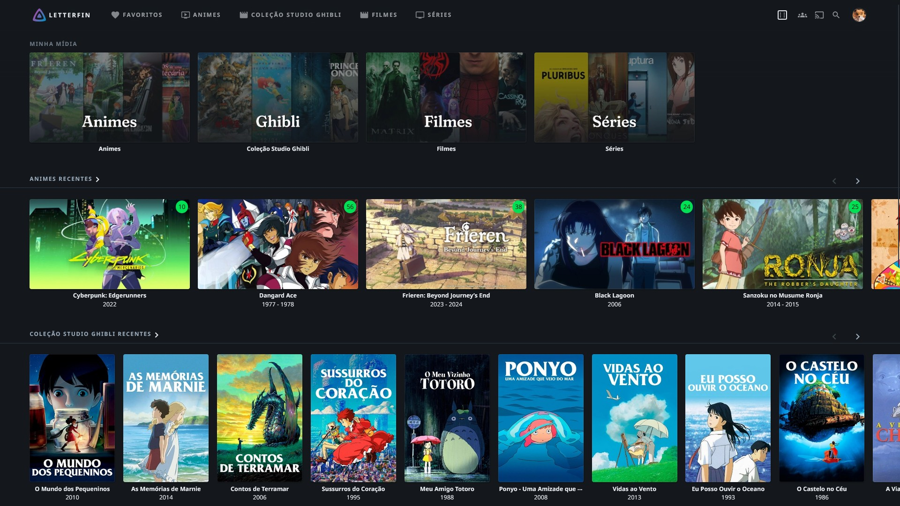
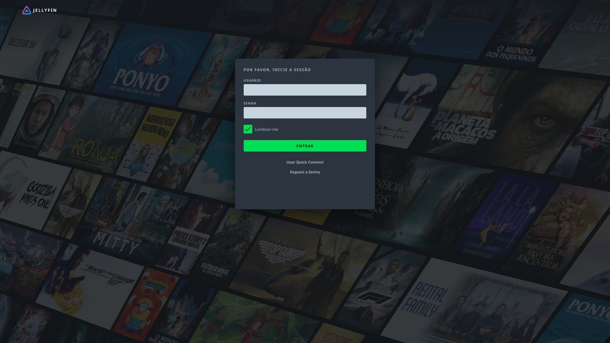
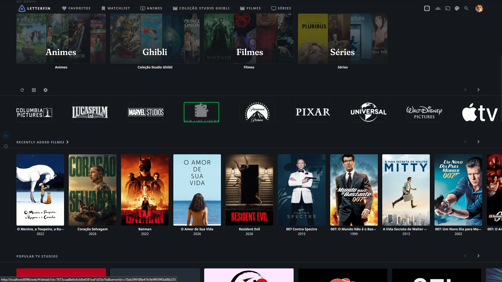

# Letterfin

A **simple** dark theme for **Jellyfin 12.0** (Modern layout), with a cinematic look: graphite background, blue-gray surfaces and a green accent.

Inspired by Letterboxd, with some creative liberties.

> **Disclaimer:** Letterfin is an independent, unofficial project. It is **not affiliated with, endorsed by, or connected to Letterboxd** in any way.

## Install

1. In Jellyfin, open **Dashboard → General → Custom CSS code** (for all users) or **Settings → Display → Custom CSS code** (just you).
2. Paste this line and save:

```css
@import url("https://cdn.jsdelivr.net/gh/OnlyTito/letterfin@main/theme/letterfin.css");
```

3. Select the **Dark** theme and the **Modern** layout, then hard-refresh the page (Ctrl+F5).

### Media Bar (optional)

Letterfin can also style the [Media Bar](https://github.com/IAmParadox27/jellyfin-plugin-media-bar) plugin. Install the plugin first, then add this line **below** the first one:

```css
@import url("https://cdn.jsdelivr.net/gh/OnlyTito/letterfin@main/theme/letterfin-media-bar.css");
```

## Fonts

Titles use [Fraunces](https://fonts.google.com/specimen/Fraunces), loaded from Google Fonts. If the font can't be loaded, your system's serif font is used instead.

## Customize

All colors, spacing, radius and fonts are variables at the top of `letterfin.css` (`--lf-*`).

## Preview

<table>
  <tr>
    <td align="center" width="50%">
      <strong>Home</strong><br>
      
    </td>
    <td align="center" width="50%">
      <strong>Home — No Media Bar</strong><br>
      
    </td>
  </tr>
  <tr>
    <td align="center" width="50%">
      <strong>Login</strong><br>
      
    </td>
    <td align="center" width="50%">
      <strong>Movie Profile</strong><br>
      
    </td>
  </tr>
  <tr>
    <td colspan="2" align="center">
      <strong>Showcase</strong><br><br>
      
    </td>
  </tr>
</table>

## Uninstall

Remove the `@import` lines from the Custom CSS field.
